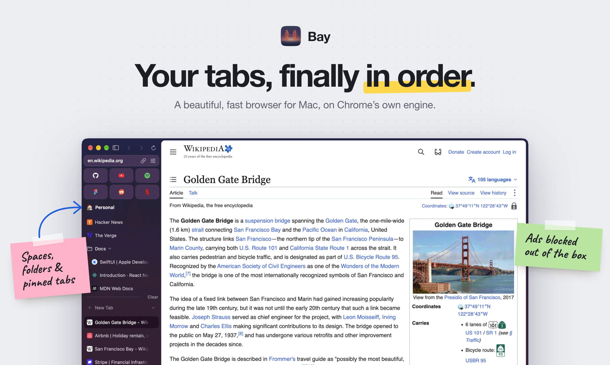
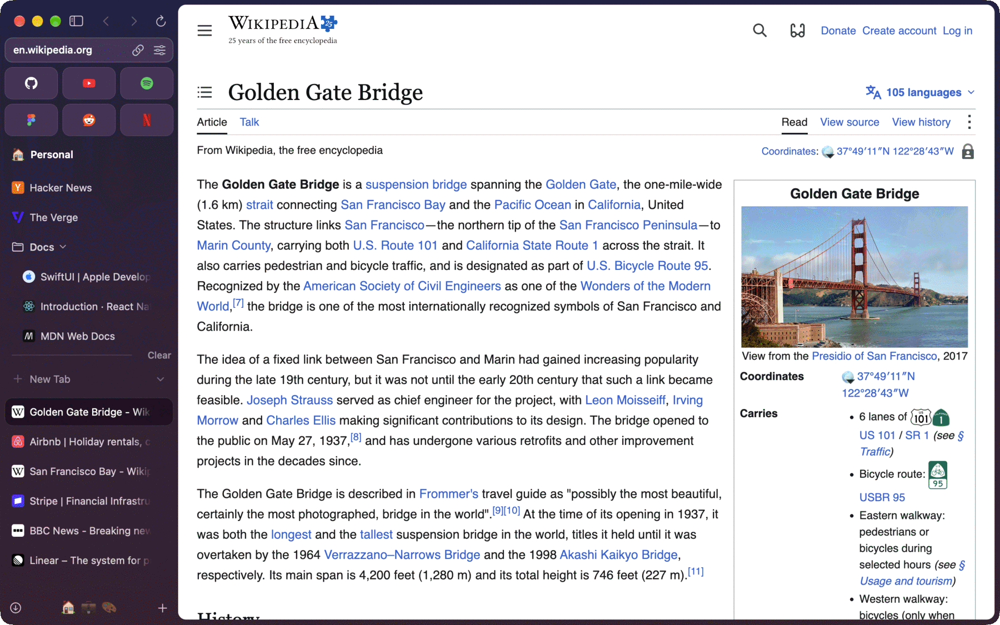
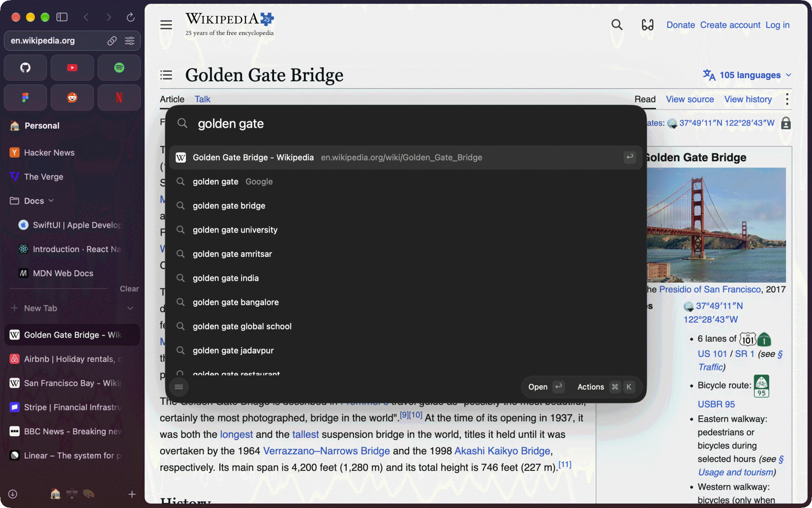
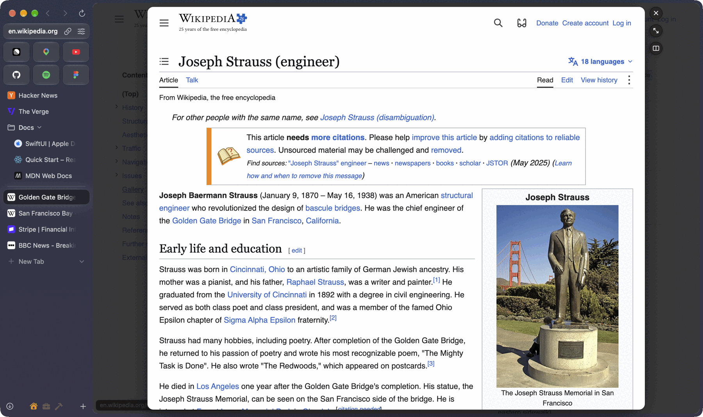
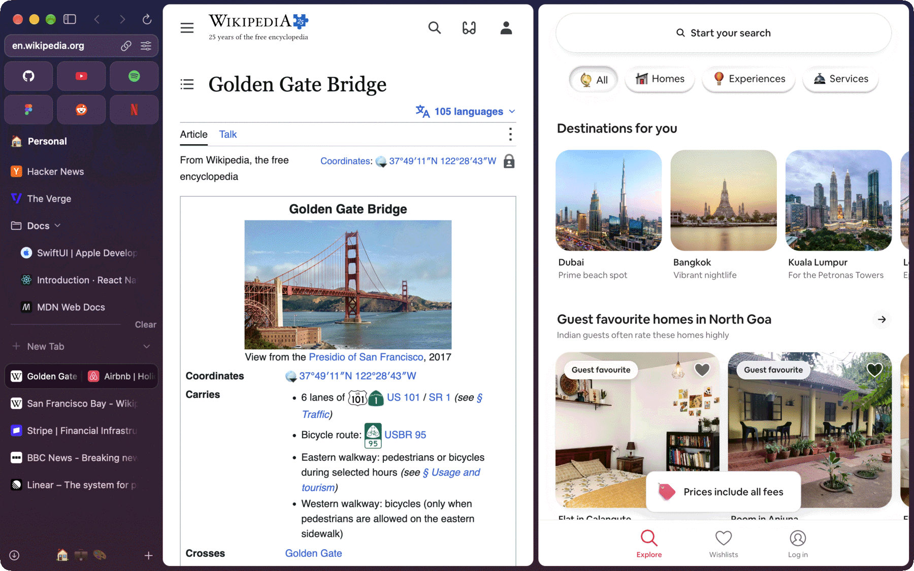

<p align="center">
  
</p>

<p align="center">
  A beautiful, fast browser for Mac that brings everything you loved about Arc.<br>
  Built on Chrome's own engine, so every site works the way it does in Chrome.
</p>

<p align="center">
  <a href="https://bay.krishkalaria.in">Website</a> ·
  <a href="https://github.com/krishkalaria12/bay/releases">Releases</a> ·
  <a href="#reporting-issues">Report an issue</a> ·
  <a href="#contributing">Contribute</a>
</p>



## What Bay is

Bay is a Mac browser built around a sidebar. Your favorites sit on top, pinned tabs and folders under
them, and the day's tabs below. Spaces keep work and home apart, each with its own theme and its own
sign-ins. Tabs you stop using are put away for you, but you can still find them with a search.

Under the window is Chrome's own framework, a patched Chromium. Pages render, sign in and behave as
they do in Chrome, and Chrome Web Store extensions install as they would there. Everything you touch is
Bay's own: the window, sidebar, command bar, menus and animations.

## Features

**From Arc, kept**

- **Sidebar.** Favorites as tiles on top, pinned tabs under them, today's tabs below. It can sit on
  either side, auto-hide, or turn into a top tab bar. Hold Option to see a hidden sidebar, and use a mouse's side
  buttons over it to change space. Favorites show unread counts from Gmail, Slack, X and other sites.
- **Spaces.** Each has its own icon, colour theme and profile, so sign-ins stay apart. Swipe between them.
- **Pinned tabs and folders.** Kept open a click away, and never closed by tidying. ⌘. focuses the sidebar;
  arrows move through its rows and folders, Return opens, Space peeks, and Escape returns to the page.
- **Sidebar undo.** ⌘Z reverses closes, clearing, moves, pinning, names, icons and themes in the window where
  you edited them. Page editors and text fields keep their own Undo.
- **Finder files.** Drop files or folders into the pinned section. Folders expand in place; PDFs, images and
  HTML open in tabs. Drag a file row into a website to upload it. Synced pins ask for local access on another Mac.
- **Old tabs put away.** Unused tabs leave after a time you choose for each space, say twelve hours for
  work and a week for home. They stay one search away.
- **Peek.** A link opens over the page. Keep it as a tab or move it beside the page.
- **Split View.** Two or more tabs side by side in one tab.
- **Little Bay.** Links from Slack, Mail or Discord open in a small window of their own. Open one from any app
  with a shortcut or the menu bar (Settings › Links). Windows left alone are put away after six hours, into the
  Library's archive.
- **Command bar.** One place for addresses, searches, open tabs and the ones put away (⌘L, or ⌘T for a
  new tab). ⇧↩ on a search opens its top result.
- **Capture.** ⇧⌘2 lights up the part of the page under the pointer. Click it, or drag over any area, then copy,
  save to Library, add to an Easel, share or mark up the picture. Capture Full Page saves the whole page to Downloads,
  and Capture in Portrait frames the page on your space's colours.
- **Easels.** Local whiteboards for captures, images, links, text and drawings. Move and resize objects, pan and
  zoom, undo edits, or make a capture live. Create one with ⌃⇧E or “New Easel” in the command bar. Export as PNG
  or a self-contained HTML file. Closing its pinned tab keeps the Easel in Library.
- **Library.** The books button at the foot of the sidebar gathers saved media, downloads, Easels, Spaces and
  archived tabs. Hover it to drag recent files, or type “Open Library” in the command bar.
- **Previews.** Hover a folder, a Gmail or GitHub tab, or a calendar to see what's inside without
  opening it. ⌃⌘J joins the meeting that's on now.
- **Boosts.** Change how a site looks: tint it from a colour wheel or your space's colours, invert it, pick a font,
  size and case, zap away what you don't want (or keep one part alone with Focus), and add your own CSS, live as you
  edit. Boost This Site is in Site Controls, the command bar and a tab's menu; Library › Boosts lists them all.
  Boosts sync; a Boost's JavaScript stays on the Mac where you turned it on, off in private windows unless you allow it.
- **Developer Mode.** Local servers get the full address, an inspector and DevTools a click away. JSON responses
  show as a tree you can fold, with the raw text a click away.

**Bay's own**

- **Ad blocking built in**, with uBlock Origin.
- **Chrome extensions** from the Chrome Web Store, with their toolbar buttons and side panels.
- **Import** from Arc (spaces, pinned tabs, folders, favorites), Chrome, Safari, Firefox, Dia, Brave,
  Opera and Helium: bookmarks, history and passwords too.
- **Encrypted sync** through a folder you choose, like one in iCloud Drive. Only your devices hold the
  key.
- **⌃Tab** switches between your most recent tabs, across spaces.
- **Picture in picture** that follows a video when you switch tabs, and media controls in the sidebar.
- **Touch ID** before saved passwords or card numbers show, or passwords are exported.
- **Passkeys** from Touch ID, your phone or a security key.
- **Sits still.** Idles under half a percent of CPU with a tab open.
- **Updates** arrive on their own through Sparkle.

<table>
  <tr>
    <td width="50%"></td>
    <td width="50%"></td>
  </tr>
  <tr>
    <td align="center"><b>Command bar.</b> Open tabs, history and search in one list.</td>
    <td align="center"><b>Peek.</b> A link opens over the page without leaving it.</td>
  </tr>
  <tr>
    <td colspan="2"></td>
  </tr>
  <tr>
    <td colspan="2" align="center"><b>Split View.</b> Two tabs side by side, shown as one row in the sidebar.</td>
  </tr>
</table>

### Requirements

A Mac with Apple silicon, running macOS 14 Sonoma or later.

### Shortcuts

| Shortcut | Action |
|---|---|
| ⌘T | New tab (command bar) |
| ⌘L | Command bar for the current tab |
| ⌘W / ⇧⌘T | Close tab / reopen it |
| ⌘. | Focus sidebar, then use arrow keys |
| ⌘Z | Undo a sidebar edit |
| ⌘S | Auto-hide the sidebar |
| ⇧⌘S | Tabs in the sidebar or along the top |
| ⌘[ / ⌘] | Back / forward |
| ⌘R / ⇧⌘R | Reload / reload without the cache |
| ⌘1 – ⌘8 | Select a tab |
| ⌃Tab | Switch between recent tabs |
| ⇧↩ | Open a search's top result (command bar) |
| ⌃⌘J | Join the meeting that's on now |
| ⌃⇧= | Add a split pane |
| ⌥⇧⌘I | Send feedback |

## Reporting issues

Found a bug or have an idea? [Open an issue](https://github.com/krishkalaria12/bay/issues/new). In the
app, **Help › Send Feedback…** (⌥⇧⌘I) opens one with your Bay, engine and macOS versions filled in.

A good report has:

- Your Bay version (**Bay › About Bay**) and macOS version.
- What you did, what you expected, and what happened instead.
- The site, if it only happens on one. Check whether the same thing happens in Chrome: if it does, it's
  probably the site or Chromium rather than Bay.
- A screenshot or screen recording if it's visual. Crash reports are in Console.app, under
  **Crash Reports**.

Before opening a new issue, search the existing ones for the same problem.

**Security issues:** please don't open a public issue. Report them privately through
[GitHub's private vulnerability reporting](https://github.com/krishkalaria12/bay/security/advisories/new)
so they can be fixed before anyone else knows about them.

## Contributing

Contributions are welcome: bug fixes, features, docs and testing. For anything bigger than a small
fix, open an issue first so we can agree on the approach before you spend time on it.

1. Fork the repository and create a branch from `main`.
2. Set up the project ([Building from source](#building-from-source) below). `pnpm install` also turns
   on the git hooks: a commit formats its files with oxfmt, and a push stops if lint or the format
   check fails.
3. Make your change. Keep it focused: one fix or feature per pull request.
4. Run the checks CI runs:
   ```bash
   pnpm typecheck
   pnpm test
   pnpm lint
   pnpm fmt:check
   pnpm shaders:check
   ```
5. Commit with a [Conventional Commits](https://www.conventionalcommits.org) message on one line, such
   as `feat(sidebar): show previews for folders` or `fix(peek): keep the page's scroll position`.
6. Open a pull request against `main`. Say what changed and why, and add a screenshot or recording
   for anything visual.

Some things to know:

- **UI and behaviour** live in `apps/browser/src` (React Native macOS). Most features start there.
- **Native code** is in `packages/*/ios` (Swift and Objective-C++). After changing it, rebuild the app;
  Metro alone won't pick it up.
- **Engine code is mirrored.** Edit `engine/<layer>/src` in this repo, never the Chromium tree:
  `apply.sh` copies the repo's copy in, and `apply.sh --check` fails when the two drift apart.
- **Test against a separate profile.** The Debug app runs on its own data
  (`~/Library/Application Support/Bay Dev`, or `BAY_DATA_DIR`) and never touches your real profile.
- **Tests sit next to the code** as `*.test.mjs` files. Add one when you fix a bug in the store or
  the core logic.

## Building from source

Requires Xcode 26+, CocoaPods, Node 22+, pnpm 11, and about 50 GB of free disk for the engine.

```
apps/
  browser/            Expo + react-native-macos app (UI in src/, Xcode project in macos/)
  web/                The website, Astro + React + Tailwind (its own pnpm workspace)
engine/
  chromium/           Our Chromium code: src/chrome/browser/bay, copied in by apply.sh
  nncore/             The layer: src/bay/core, plus the hooks that make Chrome's framework link it
  patches/            The patch series (series, series.py) and the source-build steps
packages/
  nncore/             JS API over the engine (tab strips, autofill, extensions, content blocker)
  shell/              Native menu bar + shortcuts → JS, windows, SF Symbols, native primitives
  shaders/            Metal animations + grained OKLab window backdrop
  import/             Import from other browsers (bookmarks, history, passwords, Arc spaces)
  sync/               Encrypted sync: sealed files in a folder, merged on a recovery phrase
  core/               Pure TS: omnibox input → URL, suggestions, breadcrumbs (tested)
```

```bash
pnpm install
```

The engine needs a Chromium source tree in `~/chromium-build`. `scripts/download-engine` fetches the
pinned version; [BUILDING.md](BUILDING.md) has the full walk-through. Copy our code in and build
Chrome's framework (the first build takes a few hours):

```bash
engine/chromium/apply.sh
engine/nncore/apply.sh
autoninja -C out/Release_GN_arm64 chrome_framework
```

`scripts/agent/engine-build` does those steps under the Chromium lock in one command. The app's
build stages the framework from there.

```bash
pnpm pods
```

For day-to-day work, `pnpm dev:app` starts Metro, builds the Debug app when native code changed, and
opens it; saved JavaScript reloads in place. To run the steps yourself, start Metro in one terminal:

```bash
pnpm dev
```

In another, build and launch the Debug app:

```bash
pnpm macos
```

`pnpm start` builds the Release app with ad hoc signing and opens it on its own data,
`~/Library/Application Support/Bay Dev`.

Other tasks: `pnpm typecheck`, `pnpm test`, `pnpm lint` (oxlint), `pnpm fmt` / `pnpm fmt:check` (oxfmt),
`pnpm shaders:check` (compiles the embedded Metal offline), `pnpm build` (Release `.app` with a Hermes bytecode
bundle in `apps/browser/build/`). CI (`.github/workflows`) runs the same checks on every push and pull request.
Swift package tests need full Xcode for XCTest. The test runner uses `/Applications/Xcode.app`
if the selected Command Line Tools lack XCTest. Set `DEVELOPER_DIR` to use another Xcode installation;
the runner leaves the global `xcode-select` setting unchanged.

Signed releases (DMG, Sparkle zip and appcast): `scripts/release.sh <version>`, which reads its
notes from `release-notes/<version>.md` and needs a Developer ID certificate, notarytool credentials
(`scripts/.notary.env` or the `bay` keychain profile) and the Sparkle key in the login keychain
(account `bay`). The app checks `bay.krishkalaria.in/appcast.xml` for updates and links to
`bay.krishkalaria.in/release-notes/`.

### Environment variables

Most are for tests and hidden instances rather than normal use.

| Variable | Effect |
|---|---|
| `BAY_DATA_DIR` | The app's data directory. A test instance gets its own, so it never touches your real profile |
| `BAY_BACKGROUND` | `1` launches without taking focus, for smoke tests |
| `BAY_REMOTE_DEBUGGING_PORT` | The port DevTools attaches to. Like `BAY_CHROMIUM_SWITCHES` and the app's arguments, it only reaches Chrome on a scratch `BAY_DATA_DIR` or an ad hoc build, never on your real profile |
| `BAY_TEST_REAUTH` | `granted` answers Touch ID prompts in a hidden instance of a Debug or ad hoc build on a scratch profile. Shipped builds always ask |
| `BAY_JS_LOCATION` | Metro URL the native side loads the bundle from |
| `BAY_RELEASE_NOTES` | `1` shows the after-update notes even when the version matches |
| `BAY_ALLOW_AUDIO`, `BAY_ALLOW_OCCLUSION` | Let a hidden instance play sound and be treated as occluded |
| `BAY_PA_RECLAIM=fixed`, `BAY_CPU_HEALTH_SAMPLING=on`, `BAY_DISK_CHECK_SECONDS=5`, `BAY_BLUETOOTH_POLL_ON_DEMAND=off`, `BAY_HYBRID_SCAN_ON_DEMAND=off` | Put back one of Chrome's idle timers that Bay slows down, to compare idle cost |
| `BAY_IMPORT_SOURCE_DIR`, `BAY_IMPORT_SAFARI_HOME`, `BAY_IMPORT_TEST_SECRET` | Point the importer at fixture folders and a test Safe Storage key instead of the real Keychain |

### The icon

The Golden Gate's twin towers and catenary over the bay at dusk. Two sources, both in
`apps/browser/assets/`:

| File | What it's for |
|---|---|
| `app-icon.svg` | The full mark: hangers, two braces per tower, stars and ripples. Used from 64px up and in the app's own UI |
| `app-icon-small.svg` | The same mark cut heavier — no hangers, one brace, a deeper sag. The full mark turns to mush at 16-32px, which is the size the Finder uses |

`app-icon.png` is the rasterised full mark, used by the onboarding, the check-in banner and the
task manager. `macos/Bay-macOS/Assets.xcassets/AppIcon.appiconset/` is the macOS set: the small cut
for the 16 and 32 slots, the full mark from 128 up.

Rebuild every PNG from the sources:

```bash
scripts/make-icon.sh
```

It renders each SVG through headless Chrome at 1024 and downsamples with Lanczos, so it needs
Chrome and ImageMagick. The geometry in the SVGs is computed, not drawn by hand: the squircle is
`|x/a|⁵ + |y/a|⁵ = 1`, and the cable hangers sit on the same cubic béziers the cable is drawn from.

## Windows port

Bay targets desktop macOS and Windows 11 x64. The Windows port is in progress: on
Windows, Bay's React UI runs on react-native-web as a Chrome WebUI page, with tabs
embedded through SurfaceEmbed, on the same NNCore engine as macOS. See the
[port plan](docs/windows-port-plan.html) and the
[implementation status and Windows commands](docs/windows-implementation-status.md).
Mobile application targets are disabled. Native macOS code remains in packages'
existing `ios` source directories.

## License

Bay is open source under the [Apache License 2.0](LICENSE). You may use, modify and distribute it,
including commercially, as long as you keep the copyright and license notices, state the files you
changed, and pass on the [NOTICE](NOTICE) file. Contributions are accepted under the same license.

Bay builds on Chromium, the Chromium Embedded Framework and ungoogled-chromium, and ships uBlock Origin,
Sparkle and React Native, each under its own license. [NOTICE](NOTICE) lists them, and
`chrome://credits` in the app has Chromium's full list.

Bay is an independent browser. It isn't affiliated with or endorsed by The Browser Company, makers of
Arc, or by Google.
